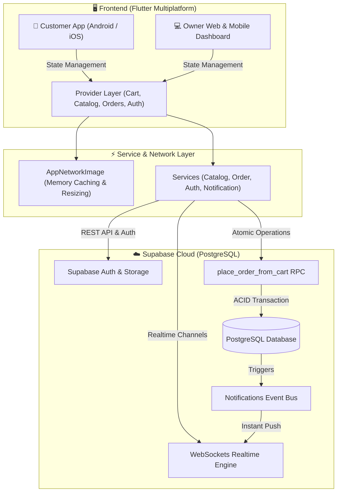

<div align="center">

  

  # 🛍️ Scarvs Store | متجر (تمنى)

  <p>
    <strong>A Modern, Full-Stack E-Commerce Solution for Fashion, Apparel & Retail (Mobile & Web)</strong><br>
    <strong>تطبيق متجر إلكتروني متكامل وعصري للتجارة الإلكترونية والتسوق مدعوم بالكامل بسحابة Supabase</strong>
  </p>

  <p>
    <a href="https://flutter.dev"></a>
    <a href="https://dart.dev"></a>
    <a href="https://supabase.com"></a>
    <a href="https://www.postgresql.org"></a>
    <a href="#"></a>
    <a href="#"></a>
  </p>

  <p>
    <a href="#-نظرة-عامة-باللغة-العربية"><strong>العربية</strong></a> •
    <a href="#-features-matrix--مصفوفة-الميزات"><strong>Features</strong></a> •
    <a href="#-architecture--database"><strong>Architecture</strong></a> •
    <a href="#-getting-started--setup"><strong>Quickstart</strong></a> •
    <a href="#-build--deployment"><strong>Deployment</strong></a>
  </p>

</div>

---

<div dir="rtl">

## 🌟 نظرة عامة (Overview)

**متجر  ( Store / متجر تمنى)** هو نظام تجارة إلكترونية احترافي متكامل لإدارة ومبيعات المنتجات العصرية (الملابس، الأزياء، والإكسسوارات). يجمع بين:
1. **تطبيق عميل فائق الأداء (Customer App):** تجربة تسوق سلسة وسريعة مع دعم كامل للغة العربية (RTL) وثيمات متكيفة (Dark/Light).
2. **لوحة تحكم للمالك متعددة المنصات (Owner Admin Dashboard):** تعمل كتطبيق هاتف أو منصة ويب سحابية **Flutter Web** لإدارة الطلبات، المبيعات، والكتالوج في الوقت الفعلي.
3. **بنية تحتية سحابية متقدمة (Supabase Backend):** تضمن حماية البيانات عبر RLS، والتحديثات اللحظية عبر WebSockets، والعمليات المالية الذرية (Atomic RPC Transactions).

</div>

---

## 📱 Features Matrix | مصفوفة الميزات

<table>
  <thead>
    <tr>
      <th width="50%">🛒 تجربة العميل (Customer App)</th>
      <th width="50%">👑 لوحة تحكم المالك (Owner Dashboard)</th>
    </tr>
  </thead>
  <tbody>
    <tr>
      <td>
        <ul>
          <li><b>تصفح ذكي:</b> استعراض وتصنيف المنتجات حسب الأقسام والتصنيفات مع بحث فوري متقدم.</li>
          <li><b>المتغيرات والخيارات:</b> دعم خيارات متعددة لكل منتج (المقاسات، الألوان، الخصائص) مع مزامنة المخزون اللحظي لكل خيار.</li>
          <li><b>سلة تسوق ذكية:</b> فحص تلقائي لكمية المخزون مع حاسبة الشحن المجاني.</li>
          <li><b>خيارات دفع متعددة:</b> الدفع عند الاستلام (COD) أو البطاقات الإلكترونية.</li>
          <li><b>تتبع الطلبات:</b> واجهة مرئية لمراحل الشحن والتوصيل خطوة بخطوة.</li>
          <li><b>إشعارات حية:</b> تنبيهات فورية بكل تحديث يطرأ على الطلب.</li>
          <li><b>واجهة عربية أنيقة:</b> محاذاة RTL دقيقة مع دعم الثيم الليلي والفاتح.</li>
        </ul>
      </td>
      <td>
        <ul>
          <li><b>متوافقة مع الويب والموبايل:</b> تعمل على الهواتف والمتصفح (Flutter Web).</li>
          <li><b>مؤشرات مالية حية:</b> إجمالي الأرباح، مبيعات اليوم والشهر، والطلبات الجديدة.</li>
          <li><b>رادار المخزون:</b> تنبيهات تلقائية عند انخفاض أو نفاد كمية أي منتج أو مقاس.</li>
          <li><b>إدارة مسار الطلبات:</b> قبول، تجهيز، شحن، وتسليم بنقرة زر واحدة.</li>
          <li><b>استرجاع المخزون التلقائي:</b> إعادة المنتجات للمخزون فور إلغاء الطلب.</li>
          <li><b>إدارة الكتالوج:</b> إضافة وتعديل وحذف المنتجات والتصنيفات ورفع الصور سحابياً.</li>
          <li><b>التحكم بالإعدادات:</b> تخصيص رسوم الشحن وطرق الدفع المقبولة.</li>
        </ul>
      </td>
    </tr>
  </tbody>
</table>

---

## 🏗️ Architecture & Database

### System Diagram



---

## ⚡ Performance Optimizations | تحسينات الأداء الفائقة

> [!TIP]
> تم تطبيق معايير هندسية متقدمة لضمان سرعة فائقة واستهلاك ذاكرة منخفض جداً:

* 🖼️ **Unified Image Caching Layer (`AppNetworkImage`):**
  تقليل استهلاك ذاكرة الـ RAM بنسبة **تتجاوز 80%** باستخدام `cacheWidth` و `cacheHeight` المحددين مسبقاً، مع مؤشرات Shimmer سلسة وبدائل احتياطية للأخطاء.
* 🚀 **Lazy Sliver Viewport:**
  استخدام `CustomScrollView` و `SliverGrid` لبناء المنتجات الظاهرة فقط على الشاشة وتفادي هبوط الإطارات (0 Dropped Frames).
* 🔄 **Lifecycle Request Caching (`loadIfNeeded`):**
  منع إعادة جلب بيانات المستخدم أو السلة أو الإشعارات عند تكرار بناء الواجهات.
* 📦 **Atomic Transactions (Zero Over-Selling):**
  تنفيذ عمليات الشراء عبر دالة SQL مخزنة ومغلفة كعملية ذرية (Atomic Transaction) لضمان عدم بيع كمية غير متوفرة تحت أي ظرف.
* ✨ **Lightweight Lottie Splash:**
  شاشة افتتاحية ذكية بحجم **165 KB فقط** (انخفاض بنسبة 81% عن الحجم الأصلي)، متوافقة مع الثيمين الفاتح والداكن.

---

## 🗄️ Database Schema & Security

<div dir="rtl">

جميع الجداول مزودة بسياسات **أمان مستوى السجلات (Row Level Security - RLS)** لضمان عزل البيانات وحمايتها:

</div>

| الجدول (Table) | الوظيفة (Role) | الحماية (Security / RLS) |
| :--- | :--- | :--- |
| `profiles` | بيانات الحساب والأدوار (`customer` أو `owner`) | القراءة والتعديل لصاحب الحساب فقط، والوصول الإداري للمالك. |
| `categories` | تصنيفات وأقسام المتجر المختلفة | قراءة عامة للجميع، والإضافة والتعديل للمالك فقط. |
| `products` | بيانات المنتجات والأسعار وحالة العرض | قراءة عامة للمنتجات النشطة، والتحكم الشامل للمالك. |
| `product_variants` | المقاسات والألوان والكميات المتوفرة لكل خيار | عزل المخزون وتحديثه ذرياً عند الشراء أو الإلغاء. |
| `product_images` | معرض صور المنتج الإضافية | تخزين سحابي محمي عبر Supabase Storage. |
| `cart_items` | سلة التسوق الخاصة بكل عميل | حماية خاصة؛ لا يمكن لأي مستخدم رؤية سلة غيره. |
| `orders` | سجلات الطلبات والعناوين والإجمالي | العميل يرى طلباته فقط، والمالك يرى جميع الطلبات لإدارتها. |
| `order_items` | تفاصيل المنتجات والخيارات داخل كل طلب | مرتبطة ذرياً مع جدول الطلبات. |
| `notifications` | الإشعارات والتنبيهات الحية | تنشأ عبر PostgreSQL Triggers وتُدفع فوراً عبر WebSockets. |
| `store_settings` | إعدادات الشحن وطرق الدفع المتاحة | قراءة عامة، والتحكم مقتصر على المالك. |

---

## 🚀 Getting Started & Setup

### 1. Prerequisites | المتطلبات
* **Flutter SDK:** `>= 3.10.0`
* **Dart SDK:** `>= 3.0.0`
* **Supabase Project:** (Cloud or Self-hosted)

### 2. Environment Configuration (`.env`)
Create a `.env` file in the project root:

```env
SUPABASE_URL=https://your-project-id.supabase.co
SUPABASE_ANON_KEY=your-supabase-anon-key
```

### 3. Database Migration Scripts
Run the prepared SQL migrations located in `supabase/` sequentially in your Supabase SQL Editor:

<details>
<summary><b>📂 عرض ملفات الترحيل وقواعد البيانات (Click to Expand)</b></summary>

1. `supabase/schema.sql`  
   * ينشئ الجداول العشرة، الفهارس، علاقات المفاتيح الأجنبية، سياسات RLS، ودالة `place_order_from_cart`.
2. `supabase/seed_products.sql`  
   * يضيف بيانات أولية للمنتجات والتصنيفات والمقاسات.
3. `supabase/notifications_and_payments.sql`  
   * يفعل مشغلات الإشعارات التلقائية عند تغيير حالات الطلبات.
</details>

---

## 🛠️ Build & Deployment

```bash
# 1. تشغيل التطبيق في وضع التطوير
flutter run

# 2. فحص الكود والاختبارات المدمجة
flutter analyze lib/
flutter test

# 3. بناء نسخة الأندرويد النهائية (Release APK)
flutter build apk --release
# الناتج: build/app/outputs/flutter-apk/app-release.apk

# 4. بناء حزمة متجر قوقل بلاي (AAB)
flutter build appbundle --release

# 5. بناء لوحة التحكم السحابية للويب (Flutter Web)
flutter build web --no-tree-shake-icons
# المجلد الناتج: build/web (جاهز للنشر على Netlify أو Vercel أو GitHub Pages)
```

---

<div align="center">

## 📄 License & Credits

Built with ❤️ using **Flutter** & **Supabase**.  
Ready for production and custom business adaptations.

<p>
  <a href="#">Back to top ⬆️</a>
</p>

</div>
